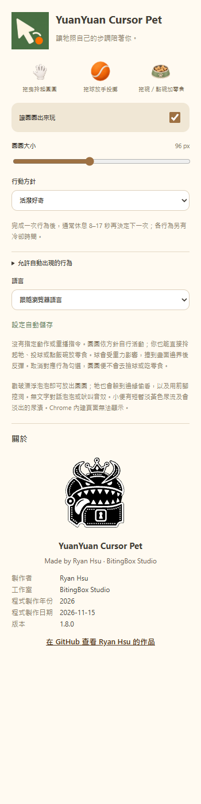
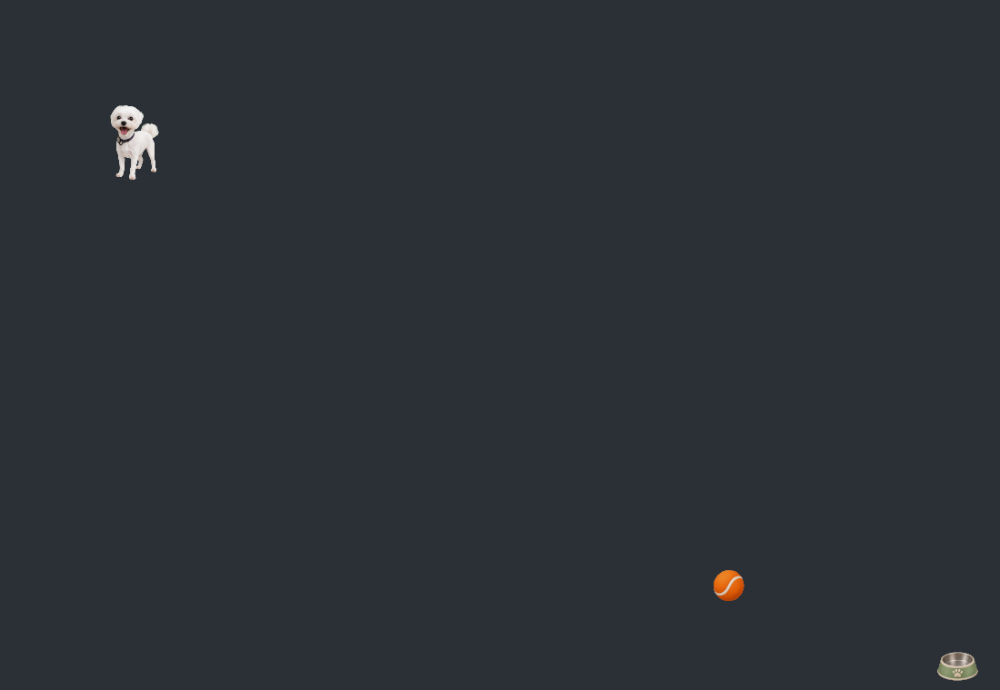

# YuanYuan Cursor Pet

圓圓是一隻會在網頁上自己活動的白色小狗 Chrome 擴充功能（Manifest V3）。牠依「行動方針」自主決定要散步、玩球、吃零食、睡覺或撒嬌，你也能直接拎起牠、丟球、拖飯碗餵食。

A Chrome extension (Manifest V3) with an autonomous little white dog that lives on your web pages: it walks, fetches, eats treats, naps, digs and peeks — and you can pick it up, throw the ball or feed it.

## 安裝 / Install

1. 下載 [Releases](../../releases) 中最新的 ZIP 並解壓縮，或直接 clone 這個 repo。
2. 開啟 `chrome://extensions`，打開右上角「開發人員模式」。
3. 按「載入未封裝項目」，選擇 `YuanYuan-Cursor-Pet` 資料夾（含 `manifest.json`）。
4. 重新整理一般網頁，從工具列的「游標＋橘色小球」圖示開啟設定。

Download the latest ZIP from Releases (or clone), open `chrome://extensions`, enable Developer mode, choose **Load unpacked** and select the `YuanYuan-Cursor-Pet` folder.

## 功能 / Features

- 21 種自主行為：跟隨、散步、嗅聞、探索、丟接球、吃零食、睡覺、小便、吠叫、撒嬌、泡泡漂浮、邊緣藏身偷看、前腳挖洞、魚眼大頭探看等。
- 4 種行動方針（乖巧安靜／親人撒嬌／活潑好奇／調皮搗蛋），各有不同權重、休息間隔與冷卻時間；可勾選允許出現的行為。沒有直接下指令的選單。
- 直接互動：拖曳拎起圓圓（隨滑鼠晃動、放手短距離落地）、拖球投擲、拖動或點擊飯碗餵食；球與飯碗隨圓圓大小等比例縮放。
- 球的物理：固定地板高度、預設彈跳高度、只在左右邊界反彈。
- 影片全螢幕、YouTube 全螢幕或瀏覽器全螢幕（F11）時自動隱藏，離開後恢復。
- 狗籠名單：右鍵網頁可加入或移出目前網站，設定面板可管理名單。同網域全部路徑適用，子網域分開。
- 介面支援繁體中文、简体中文、English、日本語、한국어。
- 使用 `storage` 與 `contextMenus` 權限；不讀取網頁內容、無外部請求或追蹤。

詳細說明見 [使用說明](YuanYuan-Cursor-Pet/使用說明.md)，測試紀錄見 [驗證紀錄](YuanYuan-Cursor-Pet/驗證紀錄.md)。

隱私權政策 / Privacy policy：[繁體中文與 English](https://ryanxuwei.github.io/YuanYuan-Cursor-Pet/privacy.html)。

## 支持 BitingBox Studio / Support

[Give Me A Boba! · 請我喝珍奶](https://bitingbox.bobaboba.me)

謝謝支持，讓創意繼續！🧋 Thanks for keeping my creativity going!

自願支持，不影響擴充功能使用。點擊會開啟外部贊助網站。

## 限制 / Limitations

- 只在一般 HTTP/HTTPS 網頁的可視範圍內活動，無法出現在 Chrome 內建頁面、其他程式或桌面。
- 未上架 Chrome 線上應用程式商店。
- 圖像素材為 AI 輔助生成的視覺近似。

## 製作資訊 / Credits

Made by Ryan Hsu · BitingBox Studio

- 製作者：Ryan Hsu
- 工作室：BitingBox Studio
- 程式製作年份：2026
- 程式製作日期：2026-11-15
- 目前版本：1.11.0
- [在 GitHub 查看 Ryan Hsu 的作品](https://github.com/RyanXuwei)

本 repo 目前未附開源授權。BitingBox Studio 標誌與圓圓角色圖像的使用範圍另依品牌規範，不隨程式碼授權。
