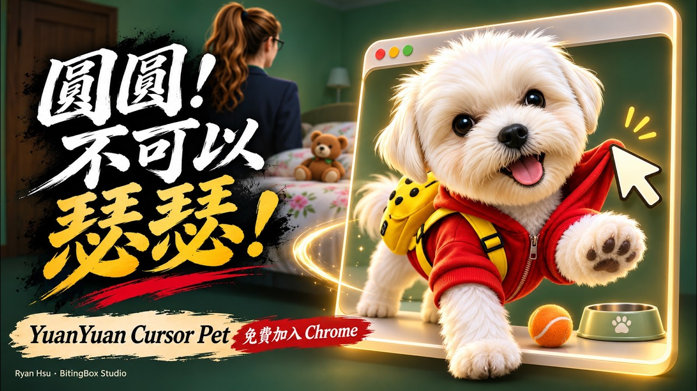
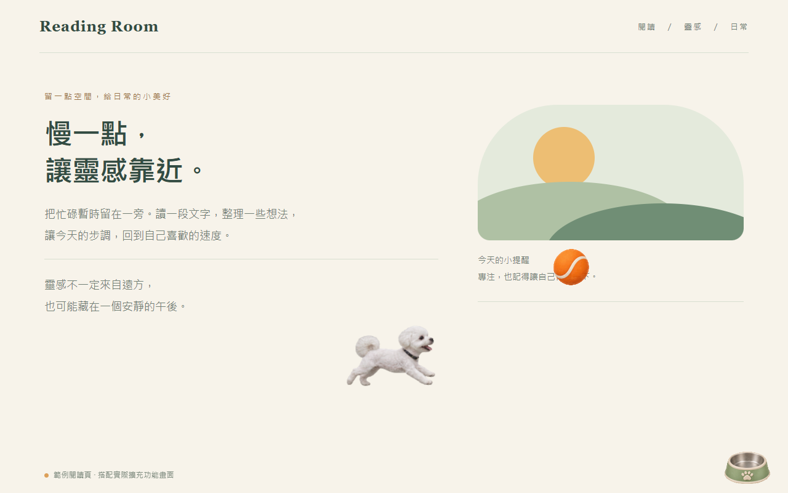
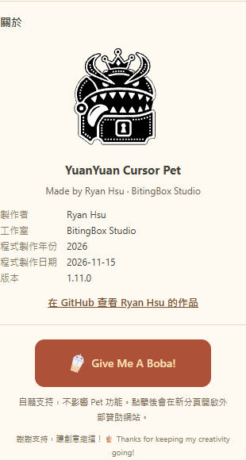

# YuanYuan Cursor Pet

### 一隻住在你網頁上的白色小狗

上網上累了，抬頭就看到圓圓在旁邊散步、追球、打瞌睡。 
牠會自己決定今天要乖乖陪你，還是到處搗蛋。免費、免註冊、不追蹤。

*A little companion. A brighter browsing day.*

&nbsp;

### 🎬 宣傳短片｜圓圓，不可以瑟瑟！

床上管不住？那就送進你的瀏覽器。 
看圓圓被抓包，再把這隻調皮的小狗帶到你的網頁上。

**[▶ 到 YouTube 看完整宣傳影片](https://www.youtube.com/watch?v=LFQuWQH0gLQ)**

## 為什麼你會喜歡圓圓

| | |
|---|---|
| 🐶 **牠有自己的個性** | 21 種自主行為：散步、嗅聞、追球、吃零食、睡覺、吠叫、撒嬌、邊緣偷看、前腳挖洞、魚眼大頭探看……沒有指令選單，圓圓自己決定下一步。 |
| 🎭 **四種行動方針** | 乖巧安靜、親人撒嬌、活潑好奇、調皮搗蛋。挑一種個性，再勾選你想看到的行為。 |
| ✋ **伸手就能玩** | 拖曳拎起圓圓，牠會隨滑鼠晃動；甩出網球看牠追；拖動飯碗餵零食，吃到一半把碗搶走，牠會追過去繼續吃。 |
| 🫧 **意外的小驚喜** | 偶爾被泡泡帶著飄起來，或從視窗邊緣探頭偷看你。 |
| 🎬 **看影片不打擾** | 影片、YouTube 或 F11 全螢幕時自動躲起來，離開全螢幕再回來。 |
| 🏠 **想專心就關進狗籠** | 在網頁按右鍵，就能讓圓圓不要出現在這個網站。 |
| 🌏 **五種語言** | 繁體中文、简体中文、English、日本語、한국어，跟著瀏覽器語言自動切換。 |
| 🔒 **安心又輕巧** | 必要權限仍為 storage 與 contextMenus，不讀取網頁內容、沒有廣告追蹤；預設不連網。啟用寵物消息後，才使用可選的 Google News 存取權抓取 RSS。 |

## 功能

- **21 種自主行為**：跟隨、散步、嗅聞、探索、丟接球、吃零食、睡覺、小便、吠叫、撒嬌、泡泡漂浮、邊緣藏身偷看、前腳挖洞、魚眼大頭探看等。
- **4 種行動方針**：各有不同權重、休息間隔與冷卻時間；可勾選允許出現的行為。
- **直接互動**：拖曳拎起圓圓（隨滑鼠晃動、放手短距離落地）、拖球投擲、拖動或點擊飯碗餵食；球與飯碗隨圓圓大小等比例縮放（48–160 px）。
- **球的物理**：固定地板高度、預設彈跳高度、只在左右邊界反彈。
- **全螢幕自動隱藏**：影片全螢幕、YouTube 全螢幕或瀏覽器全螢幕（F11）時隱藏，離開後恢復。
- **狗籠名單**：右鍵網頁可加入或移出目前網站，設定面板可管理名單。同網域全部路徑適用，子網域分開。
- **五種語言**：繁體中文、简体中文、English、日本語、한국어。

## 安裝

**從 Chrome 線上應用程式商店安裝（推薦）**

1. 打開 [YuanYuan Cursor Pet 商店頁面](https://chromewebstore.google.com/detail/yuanyuan-cursor-pet/feodmaldlbhnchhncfacjnpeljcgidap)。
2. 按「加到 Chrome」，再按「新增擴充功能」。

重新整理任一網頁，圓圓就會出現。點工具列的「游標＋橘色小球」圖示可以開關圓圓、調大小、選行動方針與語言。商店版會自動更新。

從 GitHub Release 手動安裝（開發人員模式）

1. 到 [Releases](https://github.com/RyanXuwei/YuanYuan-Cursor-Pet/releases/latest) 下載最新的 `YuanYuan-Cursor-Pet-vX.Y.Z.zip` 並解壓縮，放在固定的資料夾。
2. 在 Chrome 網址列輸入 `chrome://extensions`，打開右上角的「開發人員模式」。
3. 按「載入未封裝項目」，選擇解壓縮後的 `YuanYuan-Cursor-Pet` 資料夾（裡面有 `manifest.json`）。

手動安裝不會自動更新，新版需要重新下載。請不要同時安裝商店版與手動版，否則畫面上會出現兩隻圓圓。

> 圓圓只在一般 HTTP/HTTPS 網頁的可視範圍內活動，不會出現在 Chrome 內建頁面、新分頁、其他程式或桌面。

詳細說明見 [使用說明](YuanYuan-Cursor-Pet/使用說明.md)，測試紀錄見 [驗證紀錄](YuanYuan-Cursor-Pet/驗證紀錄.md)。

## English

**YuanYuan Cursor Pet** puts an autonomous little white dog on your web pages. It walks, sniffs, fetches, eats treats, naps, digs and peeks from the window edge, choosing what to do based on the personality you pick. Pick it up and it sways with your mouse, throw the ball, or drag the bowl to feed it. It hides automatically in fullscreen video, can be kept off any site from the right-click menu, and speaks English, 繁體中文, 简体中文, 日本語 and 한국어. Required permissions remain storage and contextMenus. It never reads page content and has no advertising tracking. Optional pet news, off by default, requests access to Google News RSS; cache and read status stay in this Chrome profile.

**Install:** get it from the [Chrome Web Store](https://chromewebstore.google.com/detail/yuanyuan-cursor-pet/feodmaldlbhnchhncfacjnpeljcgidap) and click **Add to Chrome**. To install manually instead, download the latest ZIP from [Releases](https://github.com/RyanXuwei/YuanYuan-Cursor-Pet/releases/latest), unzip it, open `chrome://extensions`, turn on Developer mode, choose **Load unpacked** and select the `YuanYuan-Cursor-Pet` folder.

## 請我喝珍奶 / Support

喜歡圓圓的話，歡迎 [Give Me A Boba! · 請我喝珍奶](https://bitingbox.bobaboba.me)，謝謝支持，讓創意繼續！🧋 
Thanks for keeping my creativity going! 自願支持，不影響擴充功能使用；點擊會開啟外部贊助網站。

---

Made by [Ryan Hsu](https://github.com/RyanXuwei) · BitingBox Studio　｜　[隱私權政策 / Privacy](https://ryanxuwei.github.io/YuanYuan-Cursor-Pet/privacy.html)　｜　目前版本：1.11.0

製作資訊 / Credits

- 製作者：Ryan Hsu
- 工作室：BitingBox Studio
- 程式製作年份：2026
- 程式製作日期：2026-11-15
- 目前版本：1.11.0
- 圖像素材為 AI 輔助生成的視覺近似。
- [在 GitHub 查看 Ryan Hsu 的作品](https://github.com/RyanXuwei)

本 repo 目前未附開源授權。BitingBox Studio 標誌與圓圓角色圖像的使用範圍另依品牌規範，不隨程式碼授權。

## 自訂你的寵物（v1.12.0）

設定面板 → **自訂寵物／替換教學**，開啟完整匯入頁。內建一鍵複製 ChatGPT 完整提示詞，列出 8 張圖、61 格動作的檔名、宮格、尺寸與動作；支援 PNG / WebP 拖曳、檔名對應、動畫預覽、透明度檢查與本機備份。8 張備齊才可套用，能隨時恢復圓圓。角色外觀會替換；球、碗、泡泡等玩具與效果保留。

[完整替換 SOP 教學](https://ryanxuwei.github.io/YuanYuan-Cursor-Pet/custom-pet.html) · [下載生成提示詞](自訂寵物完整提示詞.txt) · [下載 SOP](自訂寵物替換SOP.txt)

圖片、名稱與描述僅儲存本機，不會自動送至 ChatGPT。提示詞與詳細教學目前為繁體中文；原設定面板保留五語。AI 生成結果仍需自行檢查肢體、角色一致性及宮格排列，匯入工具無法自動修復。解除安裝前請匯出 .petpack.json 備份。

v1.12.1：每張匯入卡附原版圓圓對照動畫與完整宮格，左右同步播放、切換動作列及拖滑桿逐格檢查，方便比對生成結果的姿勢、順序與構圖。

v1.12.3：修正更新／重新載入後舊分頁出現 Extension context invalidated。舊角色偵測失效後會停止並清除；更新後請重新整理原本開啟的網頁。

## 圓圓叼回來的消息（v1.13.0）

在設定的「圓圓叼回來的消息」開啟並允許 Google News 存取。圓圓沿用現有動畫，嘴邊以 HTML／CSS 小報紙帶著未讀數；點一下展開資訊卡，不說人話、不新增圖片序列。也可從設定開啟獨立閱讀頁。

- 每天首次使用時搜尋，以電腦當地日期篩選當日發布的文章，每次最多 2 則；沒合適消息就留空。
- 四類優先順序：寵物時事 → 寵物旅遊 → 寵物展覽 → 獸醫相關閱讀。固定關鍵字與規則篩選，不使用 AI 搜尋或摘要。
- 依設定面板語言選新聞版：繁／簡中文採台灣版，English 採美國版，日本語採日本版，한국어採韓國版。這是新聞版選擇，不保證每篇事件都發生在該地；標題保留原文。
- 點原文或「標為已讀」可收起未讀；手動「再找消息」會跳過已讀，刷新間隔至少 1 分鐘。
- 每個 Chrome 設定檔各自保存快取與已讀，不跨電腦同步。同一設定檔的分頁共用結果，不各自重複搜尋。斷線保留今日快取；昨天的消息不冒充今日消息。
- 使用 Google News RSS，不需帳號、API Key 或自有伺服器。來源可用性可能變動，失敗會顯示狀態；不抓全文、不自動載入新聞圖片。
- 獨立閱讀頁提供「檢查本機 AI」與 Chrome 內建標題翻譯入口。僅使用已備妥的本機 Translator 模型，不自動下載、不呼叫付費 AI；不支援時照常閱讀原文，不判斷新聞真偽或醫療內容。

[新聞規格與操作教學](YuanYuan-Cursor-Pet/寵物消息使用說明.md) · [隱私說明](https://ryanxuwei.github.io/YuanYuan-Cursor-Pet/privacy.html)

GitHub 發布包為 v1.13.0；Chrome 商店更新仍需另行送審。
