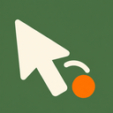
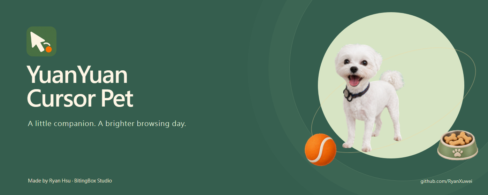
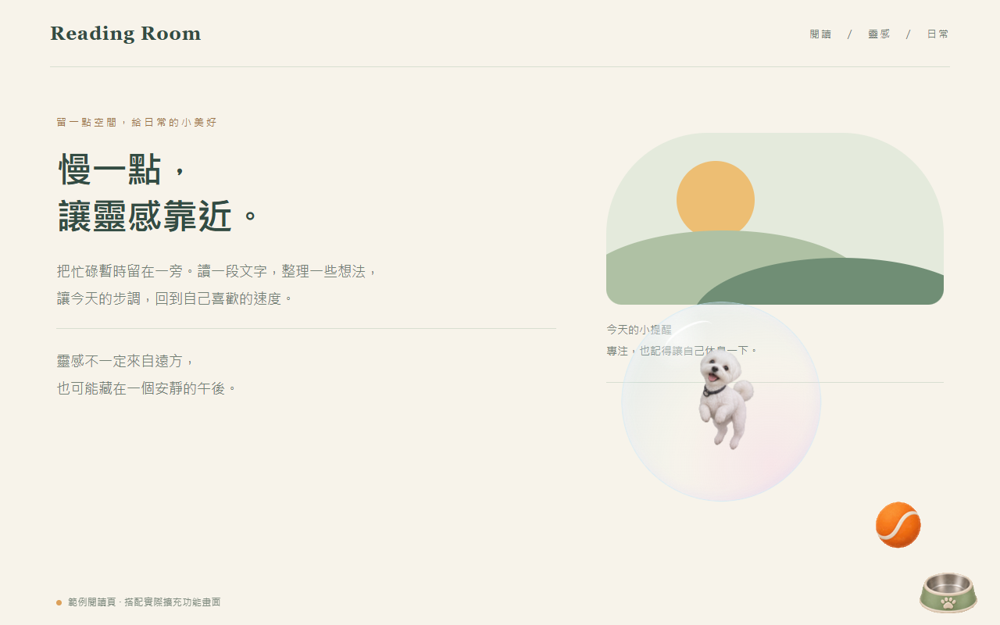

# YuanYuan Cursor Pet

### 一隻住在你網頁上的白色小狗

上網上累了，抬頭就看到圓圓在旁邊散步、追球、打瞌睡。 
牠會自己決定今天要乖乖陪你，還是到處搗蛋。免費、免註冊、不追蹤。

*A little companion. A brighter browsing day.*

&nbsp;

## 為什麼你會喜歡圓圓

| | |
|---|---|
| 🐶 **牠有自己的個性** | 21 種自主行為：散步、嗅聞、追球、吃零食、睡覺、吠叫、撒嬌、邊緣偷看、前腳挖洞、魚眼大頭探看……沒有指令選單，圓圓自己決定下一步。 |
| 🎭 **四種行動方針** | 乖巧安靜、親人撒嬌、活潑好奇、調皮搗蛋。挑一種個性，再勾選你想看到的行為。 |
| ✋ **伸手就能玩** | 拖曳拎起圓圓，牠會隨滑鼠晃動；甩出網球看牠追；拖動飯碗餵零食，吃到一半把碗搶走，牠會追過去繼續吃。 |
| 🫧 **意外的小驚喜** | 偶爾被泡泡帶著飄起來，或從視窗邊緣探頭偷看你。 |
| 🎬 **看影片不打擾** | 影片、YouTube 或 F11 全螢幕時自動躲起來，離開全螢幕再回來。 |
| 🏠 **想專心就關進狗籠** | 在網頁按右鍵，就能讓圓圓不要出現在這個網站。 |
| 🌏 **五種語言** | 繁體中文、简体中文、English、日本語、한국어，跟著瀏覽器語言自動切換。 |
| 🔒 **安心又輕巧** | 只用 `storage` 與 `contextMenus` 權限，不讀取網頁內容，沒有外部請求、廣告或追蹤。 |

## 功能

- **21 種自主行為**：跟隨、散步、嗅聞、探索、丟接球、吃零食、睡覺、小便、吠叫、撒嬌、泡泡漂浮、邊緣藏身偷看、前腳挖洞、魚眼大頭探看等。
- **4 種行動方針**：各有不同權重、休息間隔與冷卻時間；可勾選允許出現的行為。
- **直接互動**：拖曳拎起圓圓（隨滑鼠晃動、放手短距離落地）、拖球投擲、拖動或點擊飯碗餵食；球與飯碗隨圓圓大小等比例縮放（48–160 px）。
- **球的物理**：固定地板高度、預設彈跳高度、只在左右邊界反彈。
- **全螢幕自動隱藏**：影片全螢幕、YouTube 全螢幕或瀏覽器全螢幕（F11）時隱藏，離開後恢復。
- **狗籠名單**：右鍵網頁可加入或移出目前網站，設定面板可管理名單。同網域全部路徑適用，子網域分開。
- **五種語言**：繁體中文、简体中文、English、日本語、한국어。

## 安裝

1. 到 [Releases](https://github.com/RyanXuwei/YuanYuan-Cursor-Pet/releases/latest) 下載最新的 `YuanYuan-Cursor-Pet-vX.Y.Z.zip` 並解壓縮，放在固定的資料夾。
2. 在 Chrome 網址列輸入 `chrome://extensions`，打開右上角的「開發人員模式」。
3. 按「載入未封裝項目」，選擇解壓縮後的 `YuanYuan-Cursor-Pet` 資料夾（裡面有 `manifest.json`）。

重新整理任一網頁，圓圓就會出現。點工具列的「游標＋橘色小球」圖示可以開關圓圓、調大小、選行動方針與語言。

> 圓圓只在一般 HTTP/HTTPS 網頁的可視範圍內活動，不會出現在 Chrome 內建頁面、新分頁、其他程式或桌面。

詳細說明見 [使用說明](YuanYuan-Cursor-Pet/使用說明.md)，測試紀錄見 [驗證紀錄](YuanYuan-Cursor-Pet/驗證紀錄.md)。

## English

**YuanYuan Cursor Pet** puts an autonomous little white dog on your web pages. It walks, sniffs, fetches, eats treats, naps, digs and peeks from the window edge, choosing what to do based on the personality you pick. Pick it up and it sways with your mouse, throw the ball, or drag the bowl to feed it. It hides automatically in fullscreen video, can be kept off any site from the right-click menu, and speaks English, 繁體中文, 简体中文, 日本語 and 한국어. It only uses the `storage` and `contextMenus` permissions, never reads page content, and makes no external requests or tracking.

**Install:** download the latest ZIP from [Releases](https://github.com/RyanXuwei/YuanYuan-Cursor-Pet/releases/latest), unzip it, open `chrome://extensions`, turn on Developer mode, choose **Load unpacked** and select the `YuanYuan-Cursor-Pet` folder.

## 請我喝珍奶 / Support

喜歡圓圓的話，歡迎 [Give Me A Boba! · 請我喝珍奶](https://bitingbox.bobaboba.me)，謝謝支持，讓創意繼續！🧋 
Thanks for keeping my creativity going! 自願支持，不影響擴充功能使用；點擊會開啟外部贊助網站。

---

Made by [Ryan Hsu](https://github.com/RyanXuwei) · BitingBox Studio　｜　[隱私權政策 / Privacy](https://ryanxuwei.github.io/YuanYuan-Cursor-Pet/privacy.html)　｜　目前版本：1.11.0

製作資訊 / Credits

- 製作者：Ryan Hsu
- 工作室：BitingBox Studio
- 程式製作年份：2026
- 程式製作日期：2026-11-15
- 目前版本：1.11.0
- 圖像素材為 AI 輔助生成的視覺近似。
- [在 GitHub 查看 Ryan Hsu 的作品](https://github.com/RyanXuwei)

本 repo 目前未附開源授權。BitingBox Studio 標誌與圓圓角色圖像的使用範圍另依品牌規範，不隨程式碼授權。

